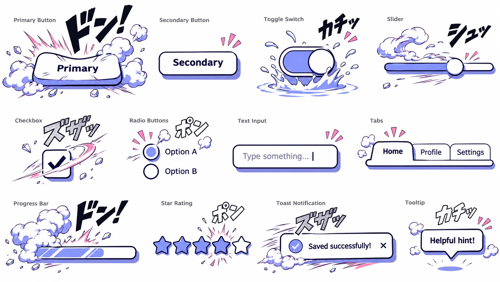
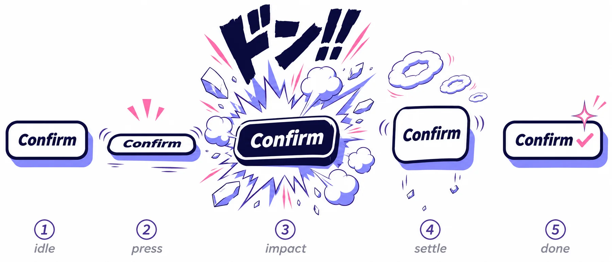
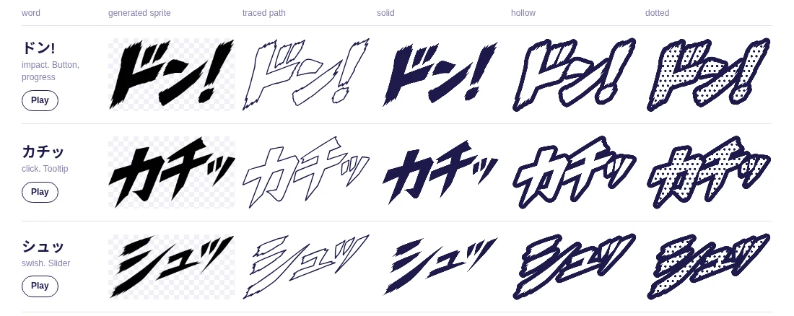
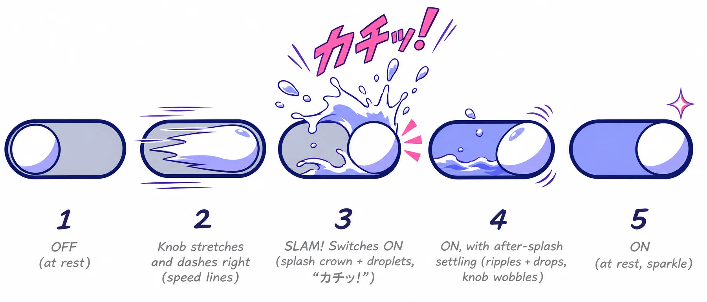
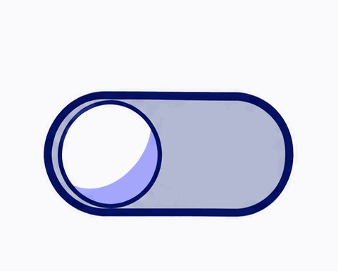
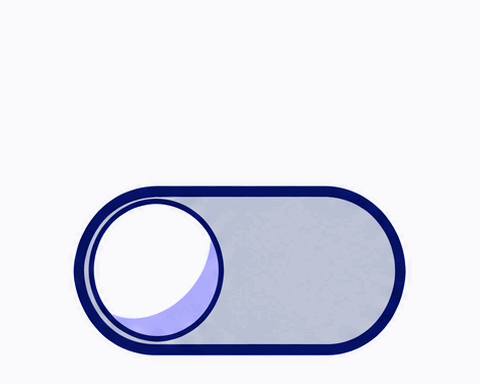
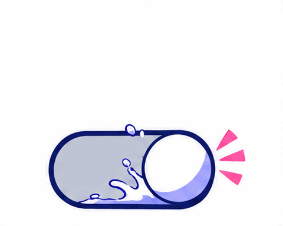
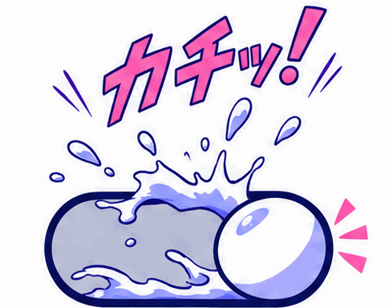
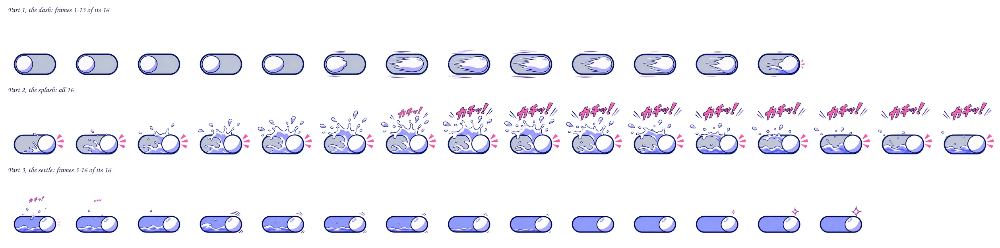

# How the art was made

Almost everything in Sakuga VFX is drawn in code while it plays: every puff, burst, chip and slash. Two things are not. The sound-effect lettering and the toggle's flip were painted with an image model. This folder shows how, with every prompt, the raw results and the attempts that failed, so you can do the same for a control of your own.

- [prompts.md](prompts.md) has every prompt and setting, in order.
- [lettering.html](lettering.html) shows each word from generated sprite to finished lettering ([live](https://sakuga-vfx.vercel.app/making-of/lettering.html)).
- `concept/` holds the kit sheet and keyframe strips the components were built to match.
- `toggle/` holds the raw GIFs the toggle is made from, the failed tries, and all 43 frames it plays.

## 1. Start on paper

Before any code, the set was drawn as a concept: one sheet with all twelve controls caught mid-reaction, and a strip of five keyframes for each control (rest, anticipation, hit, follow-through, settle). Both were generated from text alone; the prompts are in [prompts.md](prompts.md#1-the-concept).





The strips did most of the design work. Each component's reaction was written to hit those five frames, and when something looked wrong, the strip was what it was checked against. If you take one thing from this folder, take this: decide the beats as drawings first, then animate toward them.

## 2. The lettering

The words are the one thing in the effects that needed a real brush. Each was generated as **flat solid black on transparency**, with no colour, outline or shading, then turned into a vector path:

1. **Generate.** One word per image. Asking for flat black is what makes the next steps clean. [The prompts](prompts.md#2-the-lettering).
2. **Crop and scale.** Trim to the letters and scale to 520 pixels wide:
   ```sh
   magick raw.png -crop "$(magick raw.png -alpha extract -threshold 12% -format '%@' info:)" +repage -resize 520x -quality 90 art/words/NAME.webp
   ```
3. **Trace.** `tools/trace.py` traces every sprite in `art/words/` with potrace and writes the paths into `core.js`. All six words come to about 17 KB of path data, so no image files ship.
   ```sh
   uv run --with potracer --with pillow --with numpy python tools/trace.py
   node tools/build.mjs     # stamps the new core into every component
   ```
4. **Paint in code.** The core strokes a thick outline and fills the shape, so one path becomes solid, hollow or screentone, in any colour and at any size. `SakugaFX.paint(name, { col, edge, dots })` gives you one on a canvas.



## 3. The toggle: why it is drawn, not coded

The toggle's keyframe strip asks for something code does badly: the knob melts into a smear with a torn tail, slams into the end, and a crown of water erupts and floods the track.



It was built in code three times:

1. **Styled HTML on springs,** like the other controls. It moved well, but it was not the strip.
2. **Drawn shapes on a canvas,** copying the strip frame by frame: the smear and its zigzag tail, the crown as rising tongues with foam tips, teardrop drops. It had the right shapes, but not the morph of the ball or the fluid of the splash.
3. **A small fluid simulation** in a shader: the knob as a chain of blended balls that stretched with speed, the splash as particles under gravity. It moved like liquid, and it was a different drawing every time, never that drawing.

The note on the third was "It's not looking like the reference," and it was right. A simulation can only approximate a drawing. So the strip itself became the source, and the image model drew the in-betweens.

## 4. The toggle, step by step

**First try: the whole flip in one GIF.** Given the strip as a reference and asked for an animated GIF, the model drew the sequence in the same style. Two problems: it returns at most 16 frames, so the whole flip had to fit in 16 big steps (it played at 14 a second), and the switch jumped position partway through.



Two other routes failed. A 4 by 3 [sprite sheet](toggle/sheet-try.webp) changed the switch's size from cell to cell. Computing extra in-betweens from the 16 frames with motion interpolation gave ghosted double images.

**Three parts instead of one.** With the same reference, three GIFs of 16 frames each, every one covering a shorter stretch, so the steps between frames are small:

| the dash | the splash | the settle |
|---|---|---|
|  |  |  |

What made the prompts work ([all three](prompts.md#3-the-toggle)):

- **Pin the housing.** "The toggle housing must stay perfectly still at exactly the same position and size in every single frame, centred horizontally with its centre at two thirds of the frame height, leaving the top third empty for the splash and lettering."
- **Say what is constant within a part.** "In EVERY frame the track is still GREY and the round white knob sits at the RIGHT end." Each part starts mid-flip, so the prompt says what is already true in all of its frames.
- **Give the beats frame numbers.** "Frames 2-6: a water splash crown erupts…", "Frames 7-9: the crown at its tallest…"
- **Ask for no numbers or captions.** The reference strip has them, so every prompt says not to draw them.

**Align.** The parts still sit slightly differently in their frames. `tools/frames.sh` finds the switch's navy outline in every frame, scales each frame so the housing is the same width, centres it on a 480 by 520 canvas and clears the background:

```sh
mkdir -p work
sh tools/frames.sh making-of/toggle/part-1-dash.gif work a
sh tools/frames.sh making-of/toggle/part-2-splash.gif work b
sh tools/frames.sh making-of/toggle/part-3-settle.gif work c
```

**Pick and trim.** The parts overlap where one hands to the next. Laid side by side, the cut points are easy to see: the first 13 frames of the dash, all of the splash, and the last 14 of the settle make 43 frames.



**Pack and build.** `tools/sheet.sh` scales the frames to 300 by 325 (twice the size they are shown at) and packs them 8 across into one sheet; the build writes the sheet into `toggle.js`:

```sh
sh tools/sheet.sh toggle/frames.webp $(ls work/a*.webp | head -13) work/b*.webp $(ls work/c*.webp | tail -14)
node tools/build.mjs
```

Run from the GIFs in this folder, those commands rebuild the shipped sheet; the only differences are WebP compression.

**Play.** `toggle.js` draws one frame at a time onto a canvas over the switch, at 30 a second. Turning it on plays all 43; turning it off plays the 12 dash frames backwards, since a splash cannot un-splash.

## 5. Doing it for your own control

1. **Make the keyframe strip first,** and keep generating it until it is what you want. Everything after this copies it.
2. **Keep the control's body identical and still** in every frame, and describe exactly where it sits.
3. **Generate in parts of 16 frames or fewer,** one beat each, with the parts overlapping by a frame or two.
4. **Say what stays the same within each part,** and give the beats frame numbers.
5. **Align on something that never moves.** `frames.sh` keys on the outline colour `#131a5c`; change it to your control's outline.
6. **Look at every frame side by side before using any,** and trim where parts overlap.

And know what you are giving up. The frames are fixed art: the `--sk-*` colours cannot reach them, they only play forward or backward, and the toggle weighs about 500 KB where the other components are about 45 KB. Use this for the one moment that has to look drawn, and keep the rest in code.
